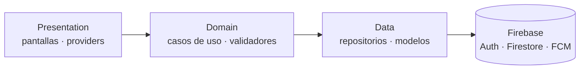

<div align="center">

# 🎓 CampusConnect

**Avisos, eventos y mapa del campus en la palma de tu mano.**

Aplicación móvil para la comunidad de la **Universidad Tecnológica del Valle del Mezquital (UTVM)**, Ixmiquilpan, Hidalgo.


[Descargar](#-descargar-la-app) · [Funciones](#-funciones) · [Arquitectura](#-arquitectura) · [Ejecutar](#-ejecutar-el-proyecto) · [Versionamiento](#-versionamiento) · [Privacidad](#-seguridad-y-privacidad)

</div>

---

## 📖 Acerca del proyecto

CampusConnect centraliza la información del campus en una sola app: avisos oficiales, eventos con fecha y lugar, calendario escolar y mapa de edificios. Cada usuario tiene su perfil y puede guardar los eventos que le interesan; los administradores gestionan usuarios y contenido.

Es un proyecto de la materia **Desarrollo Móvil Integral**, desarrollado de forma individual.

> **Autor:** Julio César Montoya Romero · Ing. en Desarrollo y Gestión de Software, 10.º cuatrimestre, grupo B

## 📲 Descargar la app

1. Entra a **[Releases](https://github.com/Julio10Mon/campusconnect/releases/latest)**.
2. Descarga el archivo `app-release.apk` desde la sección *Assets*.
3. Ábrelo en tu celular Android y acepta **"Instalar apps desconocidas"** si te lo pide.
4. Toca **Instalar**.

> Requiere **Android 8.0 (API 26)** o superior. Al instalar fuera de la tienda, Google Play Protect puede mostrar una advertencia: es normal en APK distribuidos directamente.

## ✨ Funciones

| Área | Qué puedes hacer |
|------|------------------|
| 🏠 **Inicio** | Ver el próximo evento, avisos recientes y accesos rápidos |
| 📢 **Avisos** | Publicar y leer avisos con fotografía opcional. La fecha se registra automáticamente |
| 📅 **Eventos** | Crear eventos con fecha, hora y lugar del campus; filtrar próximos y pasados; guardar favoritos |
| 🧭 **Explorar** | Calendario escolar y mapa del campus con los edificios oficiales |
| 👤 **Perfil** | Foto, carrera, descripción, estadísticas, mis publicaciones y eventos guardados |
| 🔐 **Acceso** | Correo y contraseña, Google y Facebook |
| 🔔 **Notificaciones** | Avisos push con Firebase Cloud Messaging |
| 🛠️ **Administración** | Activar o desactivar usuarios y asignar roles |

### Detalles que cuidan la experiencia

- **Sin duplicados:** una publicación idéntica (mismo título, hora y lugar) se rechaza con un mensaje claro, incluso si se pulsa dos veces.
- **Fechas válidas:** no se pueden programar eventos en el pasado y el horario se interpreta en la hora del campus.
- **Ubicaciones oficiales:** selector con los edificios A–L del campus, canchas y la opción "Otra ubicación".
- **En español:** selectores de fecha y hora, diálogos y mensajes en español de México.
- **Animaciones sobrias:** entrada escalonada de listas, respuesta al tacto y transiciones suaves; respetan la opción "reducir animaciones" del sistema.

## 🏛️ Arquitectura

Clean Architecture + MVVM con Riverpod para el estado. Más detalle en [docs/ARQUITECTURA.md](docs/ARQUITECTURA.md).



### Estructura de carpetas

```text
lib/
├── core/            # tema, constantes, rutas, utilidades y errores
├── data/            # datasources, modelos y repositorios (Firebase)
├── domain/          # contratos, casos de uso y validadores (Dart puro)
├── presentation/    # pantallas, widgets y providers de Riverpod
└── main.dart
test/                # pruebas unitarias y de widgets
docs/                # arquitectura y flujo de Git
```

### Tecnologías

| Categoría | Herramienta |
|-----------|-------------|
| Framework | Flutter · Dart |
| Estado | Riverpod |
| Navegación | go_router |
| Backend | Firebase Authentication · Cloud Firestore · Cloud Messaging |
| Diseño | Material 3 · Google Fonts (Bricolage Grotesque, Public Sans) |
| Calidad | flutter_lints · pruebas con flutter_test |

## 🚀 Ejecutar el proyecto

**Requisitos:** Flutter (canal estable), Android Studio o VS Code, y un emulador o celular Android.

```bash
git clone https://github.com/Julio10Mon/campusconnect.git
cd campusconnect
flutter pub get
flutter run
```

### Pruebas y análisis estático

```bash
flutter analyze
flutter test
```

### Compilar el APK de lanzamiento

Se necesita un almacén de claves propio y el archivo `android/key.properties` (no incluido por seguridad). Hay un ejemplo sin datos reales en [`android/key.properties.example`](android/key.properties.example).

```bash
flutter build apk --release
```

El archivo queda en `build/app/outputs/flutter-apk/app-release.apk`.

## 🌿 Versionamiento

Flujo individual: rama `main` estable y una rama `feature/*` por funcionalidad, con commits descriptivos (`feat:`, `fix:`, `docs:`, `test:`, `chore:`) e integración con `merge --no-ff`. Guía completa en [docs/FLUJO_GIT.md](docs/FLUJO_GIT.md).

| Rama | Uso |
|------|-----|
| `main` | Versión estable y funcional |
| `develop` | Integración de pruebas |
| `feature/*` | Una por funcionalidad o tarea |

| Versión | Contenido |
|---------|-----------|
| `v0.1.0` | Estructura inicial del proyecto |
| `v0.2.0` | Autenticación |
| `v0.3.0` | Avisos y eventos |
| `v1.0.0` | Funcionalidad completa: explorar, perfil y administración, con pruebas |
| `v1.2.0` | Nombres oficiales del campus, avisos sin fecha manual, app en español y animaciones |

El detalle de cada entrega está en [CHANGELOG.md](CHANGELOG.md) y los APK en [Releases](https://github.com/Julio10Mon/campusconnect/releases).

## 🗺️ Próximos pasos

- [ ] Publicar y probar las reglas de seguridad de Firestore ([`firestore.rules.propuesta`](firestore.rules.propuesta))
- [ ] Registrar la huella SHA-1 para el inicio de sesión con Google en la versión de lanzamiento
- [ ] Pruebas de integración de los flujos principales
- [ ] Capturas de pantalla en este README

## 🔒 Seguridad y privacidad

- Nunca se versionan `key.properties`, `*.jks`, `*.keystore` ni archivos `.env`.
- `google-services.json` y `firebase_options.dart` contienen identificadores públicos del proyecto Firebase (no son contraseñas) y permiten que otra persona compile la app. La protección real está en las reglas de Firestore y en restringir la llave de API en Google Cloud.
- Política de privacidad: <https://julio10mon.github.io/campusconnect/privacy.html>

## 📄 Licencia

Proyecto académico. Todos los derechos reservados por su autor mientras no se indique otra licencia.

---

<div align="center">

Hecho por **Julio César Montoya Romero** · UTVM · 2026

</div>
